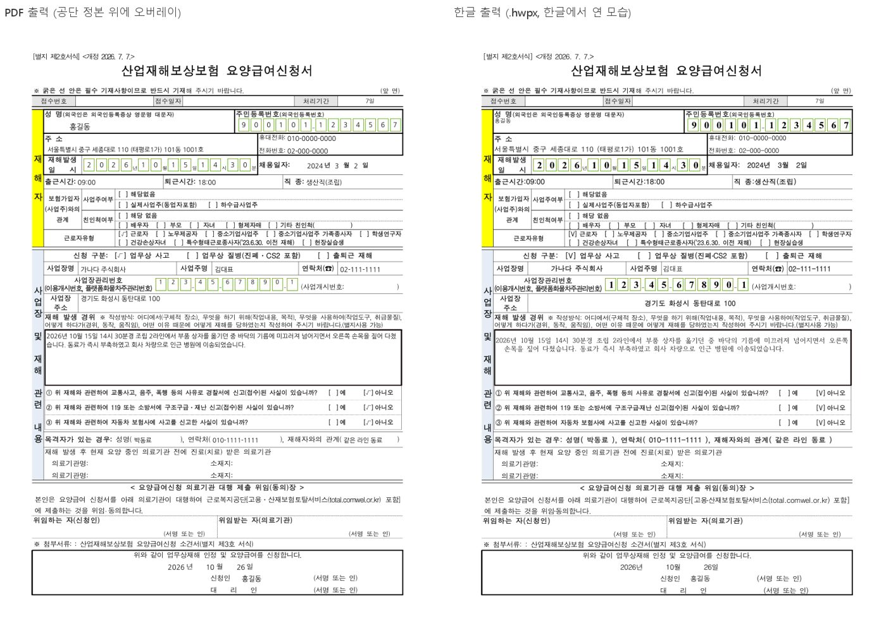

<div align="center">

# 🩹 sanjae-apply

**산재 신청 도우미 · MCP 서버 + CLI**

급여 종류와 재해 상황을 말하면 **필요한 서식·첨부·근거 조문**을 알려 줍니다.
근로복지공단 **정본 PDF 12종**도 그 자리에서 채워 줍니다.

[](https://github.com/seojaehong/sanjae-apply/releases)
[](LICENSE)
[](https://nodejs.org)
[](https://modelcontextprotocol.io)
[](test/)



<sub>합성 값으로 채운 요양급여신청서. 왼쪽이 PDF 출력, 오른쪽이 한글(.hwpx) 출력을 한글에서 연 모습입니다.</sub>

</div>

---

## ✨ 무엇을 해 주나요

산재보험은 **청구주의**입니다. 재해자나 대리인이 급여 종류마다 다른 서식과 첨부를 직접 챙겨야 합니다.
이 도구는 그 「챙기는 일」을 돕습니다.

| 하는 일 | 설명 |
|---|---|
| 📋 **필요 서식 확인** | 급여 9종(요양·휴업·장해·유족·간병료 등) × 사고/출퇴근/질병 × 제3자 유무를 받아 `REQUIRED` / `CONDITIONAL` / `NOT_APPLICABLE` 로 돌려줍니다 |
| 📎 **첨부 점검** | 이미 가진 것은 `PROVIDED`, 없는 것은 `MISSING`, 다른 서류로 갈음되는 것은 `SUBSTITUTABLE` |
| ⚖️ **근거 조문** | 산재보험법·시행령·시행규칙 조문 번호와 제목을 함께 붙입니다(법제처 국가법령정보 Open API) |
| ❓ **남은 질문** | 아직 답이 없는 분기는 `open_confirmations` 로 되돌려 줍니다. 모르는 것을 지어내지 않습니다 |
| 🖨️ **PDF 채우기** | 공단 서식자료실 정본 PDF 위에 값을 얹어 돌려줍니다. 신청인 칸만 채우고 의사·사업주·공단 칸은 비웁니다 |

> [!IMPORTANT]
> **승인 여부는 다루지 않습니다.** 결과의 `READY_TO_SUBMIT` 은 「제출할 수 있는 상태」이지 승인이 아닙니다.
> 결과를 점치는 표현은 코드 필터가 출력 단계에서 막습니다.

> [!NOTE]
> **입력값을 저장하지 않습니다.** 로컬 설치는 PC 밖으로 아무것도 보내지 않습니다. 주민등록번호 같은 칸은 비워 두고 출력한 뒤 손으로 적어도 됩니다.

---

## 🚀 30초 설치 (내 PC, 토큰 없음)

Node.js 20 이상만 있으면 됩니다. 단계별 따라 하기와 문제 해결은 [사용 매뉴얼](docs/사용_매뉴얼.md)에 있습니다.

### Claude Code

```bash
claude mcp add --scope user sanjae-apply -- npx -y sanjae-apply mcp
```

### Claude Desktop

`claude_desktop_config.json` 에 추가합니다.

```json
{
  "mcpServers": {
    "sanjae-apply": { "command": "npx", "args": ["-y", "sanjae-apply", "mcp"] }
  }
}
```

<details>
<summary>🪟 Windows 에서 Claude Desktop 이 npx 를 못 찾을 때</summary>

`cmd /c` 로 감쌉니다.

```json
{
  "mcpServers": {
    "sanjae-apply": { "command": "cmd", "args": ["/c", "npx", "-y", "sanjae-apply", "mcp"] }
  }
}
```
</details>

<details>
<summary>🧩 Cursor · Windsurf · 그 밖의 MCP 호스트</summary>

같은 `command` / `args` 를 각 도구의 MCP 설정에 넣습니다. stdio 전송이면 전부 됩니다.
</details>

붙이고 나서 AI 에게 이렇게 말해 보세요.

> 「출퇴근 중 교통사고인데 상대 운전자가 있어요. 요양급여 신청하려면 뭐가 필요해요?」
> 「요양급여신청서에 이 값으로 채워서 PDF 로 줘.」

---

## 💻 명령줄로 쓰기

```bash
# 필요 서식·첨부·근거 조문
npx -y sanjae-apply check YOYANG --accident COMMUTE --third-party yes
npx -y sanjae-apply check JANGHAE --tags NOISE_HEARING_LOSS --json

# 서식 정본 대장과 채울 수 있는 칸 이름
npx -y sanjae-apply catalog F_YOYANG_APPLY

# 공단 정본 PDF 위에 채우기
npx -y sanjae-apply fill F_YOYANG_APPLY values.json --out 신청서.pdf

# 같은 값을 한글 문서(.hwpx)로. 확장자만 바꾸면 됩니다
npx -y sanjae-apply fill F_YOYANG_APPLY values.json --out 신청서.hwpx

# PDF 에 도장까지. 이름만 주면 성명인을 만들어 신청인 서명란 전부에 찍습니다
npx -y sanjae-apply fill F_YOYANG_APPLY values.json --out 신청서.pdf --stamp 홍길동
npx -y sanjae-apply fill F_YOYANG_APPLY values.json --out 신청서.pdf --stamp-png 내도장.png --stamp-spot applicant

# 도장 PNG 만 따로 (성명인 · 사각 · 타원 · 법인형)
npx -y sanjae-apply seal --out 도장.png --name 홍길동
npx -y sanjae-apply seal --out 직인.png --shape ellipse --arc "주식회사 가나다" --center 대표이사 --bottom 123-45-67890
```

`values.json` 의 칸 이름은 `catalog <FORM_ID>` 결과의 `slots` 에 나옵니다. PDF 와 한글은 칸 이름이 같습니다. 서식이 갱신되면 `npx -y sanjae-apply@latest` 로 받습니다.

### 🔏 도장(날인)은 어떻게 되나

- `--stamp 이름` 이면 성명인(원형 기본, `--stamp-shape square|ellipse`)을 만들어 찍고 `--stamp-png` 면 가진 도장 PNG(투명 배경, 4096px 이하)를 검사한 뒤 그대로 찍습니다. 인주색 적색, 지름 42pt(약 1.5cm). 동봉 글꼴(나눔고딕)에 없는 글자(한자 등)는 빈 도장이 되지 않도록 오류로 멈춥니다. 그런 이름은 `--stamp-png` 로 가진 도장을 넣어 주세요.
- 자리는 서식마다 지도에 정해져 있고 `catalog <FORM_ID>` 의 `stamps` 에 이름이 나옵니다. 비우면 **신청인 본인 자리 전부**(`applicant` 본문 · `delegation` 위임장 · `consent` 개인정보 동의)에 찍고 `--stamp-spot a,b` 로 고릅니다. 타인 서명란(`confirm` 확인자 · `commute_reporter` 신고인 · `choice_confirmer` 등)은 이름을 적어 줄 때만 찍습니다. 지도에 없는 자리는 건너뛰고 결과의 `stamps_skipped` 에 적습니다.
- PDF 와 한글(hwpx) 출력 **둘 다** 찍힙니다. 한글에서는 서명란 문단에 「글 앞으로」 떠 있는 그림으로 들어가 글자를 밀지 않습니다(쪽 밀림 0, 11종 실측). 한글에서 열어 옮기거나 지울 수 있습니다.
- 도장은 명의자의 인격 표지입니다. **본인 또는 명의자 동의가 있는 이름만** 넣어 주세요. 등록 인감을 흉내 내는 용도가 아닙니다(사용인감 성격).

### 🖨️ 한글(hwpx) 출력은 어떻게 되나

- 공단이 배포한 **HWP 원본**을 한글에서 hwpx 로 한 번 변환해 동봉했습니다(`forms/hwpx/`). 채울 때는 한글이 필요 없습니다. zip 안 XML 의 표 칸에 값을 넣는 순수 TypeScript 입니다. 윈도우·맥·리눅스 어디서나 돕니다.
- 결과는 **.hwpx** 입니다. 한글 2014 이상에서 열어 고치고 인쇄할 수 있습니다. 서식의 글꼴·표·쪽 구성은 공단 원본 그대로입니다.
- 빈 서식에 숨어 있던 자리표시자 글자색(회색·파랑)과 1pt 상자 글자는 검정 정체로 바꿔 넣습니다. 값이 칸보다 길면 글자를 줄입니다(PDF 와 같은 규칙).
- 재활보조기구 처방전은 공단이 PDF 만 배포해 한글 출력이 없습니다.
- 새 서식을 한글로 채우게 만드는 법은 [`docs/한글지도_작성법.md`](docs/한글지도_작성법.md) 에 있습니다.

<details>
<summary>🔧 MCP 도구 5개</summary>

| 도구 | 하는 일 |
|---|---|
| `list_required_forms` | 급여·재해 분기 → 서식·첨부·조문·절차·남은 질문 |
| `get_form_catalog` | 공단 정본 대장(파일명·개정일·sha256·게시글 URL)과 채울 수 있는 서식(`fillable` PDF · `fillable_hwpx` 한글)·칸 이름·도장 자리 이름(`stamps`) |
| `fill_form` | `form_id` + 값 (+ `format: "pdf" | "hwpx"`, + `stamp: { name }` 또는 `{ png_base64 }`, `spot`) → 채운 파일(base64). 로컬 설치면 `save_to`(절대 경로)로 파일에 바로 저장 |
| `make_seal` | 이름 → 성명인(원·사각·타원) 또는 법인형(원주 법인명 + 중심 문자 + 하단 부문자) 도장 PNG(base64). 로컬 설치면 `save_to` 로 바로 저장 |
| `fill_yoyang_apply` | v0.1 호환. `fill_form(form_id="F_YOYANG_APPLY")` 과 같습니다 |
</details>

---

## 📄 채울 수 있는 서식 12종

| 서식 | 칸 수 | PDF | 한글 | 도장 자리 |
|---|---:|:-:|:-:|:-:|
| 요양급여신청서 (별지 제2호, 2026.7.7 개정) | 35 | ✅ | ✅ | 3 |
| 출퇴근 재해 합본 (신청서 + 발생신고서) | 79 | ✅ | ✅ | 4 |
| 제3자 재해 신고서 + 확인서 | 48 | ✅ | ✅ | 2 |
| 유족급여 청구서 | 75 | ✅ | ✅ | 2 |
| 본인부담 치료비 청구서 | 42 | ✅ | ✅ | 4 |
| 휴업급여 청구서 | 37 | ✅ | ✅ | 2 |
| 간병료·이송비·보조기 청구서 | 44 | ✅ | ✅ | 3 |
| 재활보조기구 처방전 (기타) | 12 | ✅ | 공단이 PDF 만 배포 | 의료기관 작성 |
| 미지급 보험급여 청구서 | 62 | ✅ | ✅ | 1 |
| 장해급여 묶음 (청구서 + 소음작업 확인서 + 선택 확인서) | 153 | ✅ | ✅ | 5 |
| 추가상병 신청서 | 25 | ✅ | ✅ | 3 |
| 재요양 신청서 | 39 | ✅ | ✅ | 3 |

- 정본은 **근로복지공단 서식자료실** 파일만 씁니다. 좌표 지도는 정본의 `sha256` 에 묶여 있어 공단이 서식을 바꾸면 시험이 먼저 깨집니다.
- 공단이 HWP 만 주는 서식은 한글에서 PDF 로 바꿔 동봉했습니다.
- 이 도구의 범위는 채운 출력물을 만드는 것까지입니다. 온라인 접수(토탈서비스)는 범위 밖입니다.

---

## 🌐 원격 MCP (운영자가 토큰을 주는 경우)

```bash
claude mcp add --transport http --scope user sanjae-apply https://sanjae-apply.vercel.app/api/mcp/mcp \
  --header "Authorization: Bearer <발급받은 토큰>"
```

같은 도구 5개가 원격으로 돕니다. 입력은 서버에 저장되지 않지만 네트워크를 거칩니다.

<details>
<summary>🏠 직접 호스팅하기(Vercel)</summary>

이 레포를 Vercel 에 올리고 환경변수를 넣으면 `/api/mcp/mcp` 가 열립니다.

| 변수 | 뜻 |
|---|---|
| `SANJAE_MCP_TOKENS` | 허용할 Bearer 토큰. 쉼표로 여러 개 |
| `LAW_GO_KR_OC` | 법제처 Open API 인증키. 조문 실시간 조회를 쓸 때만 |
</details>

---

## 🧪 검증 수준

| 층 | 내용 | 수 |
|---|---|---:|
| 규칙 | 급여 9종 × 분기, 금지어 필터 자기시험 | vitest |
| 조문 대조 | 코드의 근거 조문 ↔ 법제처에서 받은 조문 XML 제목 | 18건 |
| 서식 대장 | 코드의 서식 ↔ `forms/catalog.json` sha256 | 15종 |
| PDF 채우기 | 12종 전부 글자 위치 + **픽셀 비교**(백지 출력 사고 방지) + 육안 | 약 590칸 |
| 한글 채우기 | 11종 전부 zip 안 글자·체크 수·글자색 + **한글이 실제로 열어 PDF 로 그리는지**(COM) + 쪽수가 원본과 같은지 + 육안 | 약 650칸 |
| MCP | http · stdio 양쪽 initialize / tools/list / tools/call | SDK 클라이언트 |
| 운영 드라이런 | Vercel 운영 끝점에 공식 SDK 로 31건 | 전부 통과 |

전부 **합성 값**으로만 돌렸습니다. 실제 사건으로는 검증하지 않았습니다.

```bash
git clone https://github.com/seojaehong/sanjae-apply && cd sanjae-apply
npm ci && npm test

# 채운 PDF 를 글자 위치 + 픽셀로 검사
python scripts/verify_fill.py out.pdf forms/maps/F_YOYANG_APPLY.json test/samples/F_YOYANG_APPLY.json out.jpg forms/bundled/F_YOYANG_APPLY.pdf

# 채운 한글 파일을 검사 (한글이 있는 윈도우면 실제 렌더까지, 없으면 --no-render)
python scripts/verify_hwpx_fill.py out.hwpx test/samples/F_YOYANG_APPLY.json forms/hwpx_maps/F_YOYANG_APPLY.json out.jpg
```

설치부터 활용까지 따라 하는 사용 매뉴얼과 실측 기록은 [`docs/사용_매뉴얼.md`](docs/사용_매뉴얼.md) 에 있습니다.

새 서식의 좌표 지도는 [`docs/좌표지도_작성법.md`](docs/좌표지도_작성법.md), 한글 지도는 [`docs/한글지도_작성법.md`](docs/한글지도_작성법.md), 배포·연결 전체는 [`docs/패키징_배포_연결_가이드.md`](docs/패키징_배포_연결_가이드.md).

---

## 🗂️ 구조

```
src/core     규칙 S-01~S-13 · 서식/첨부 카탈로그 · 금지어 필터(순수 TS, IO 없음)
src/fill     overlay.ts  pdf-lib 오버레이(text / boxes / check / multiline)
             hwpx.ts     한글 hwpx 채우기(cell / after / check / digits / boxes / group, 글자색·크기 교정)
src/stamp    seal.ts 도장 PNG 생성(글리프 윤곽 래스터) · resolve.ts 자리 선택. PDF·hwpx 날인은 overlay.ts·hwpx.ts 의 stamps
src/mcp      도구 5개 · 원격(mcp-handler, Bearer) · 로컬(stdio)
src/laws     법제처 Open API 클라이언트
api/mcp      Vercel 함수
forms/       catalog.json(정본 대장) · maps/(PDF 좌표 지도 12) · bundled/(동봉 PDF 12) · hwpx/(변환 hwpx 11) · hwpx_maps/(한글 지도 11)
scripts/     comwel_forms.py(서식자료실 수집) · verify_fill.py · probe_form.py · hwp_to_hwpx.py · probe_hwpx.py · verify_hwpx_fill.py · hwpx_stamp_anchors.py(도장 앵커) · verify_hwpx_stamps.py(한글 날인 실측) · mcp_dryrun.mjs
test/        vitest 212 (formal_rules.test.ts 전수 10,368건 포함)
docs/        좌표지도 작성법 · 한글지도 작성법 · 패키징·배포·연결 가이드
```

---

## ⚖️ 경계

- 공인노무사법 제27조에 따라 청구의 대행·대리와 서류의 작성·확인은 공인노무사의 직무입니다. 이 도구는 **그 일을 돕는 도구**이지 대신하지 않습니다.
- 규칙은 산재 실무 메모(산재창고 블로그, 2025.1.14 기준)를 옮기고 법 조문으로 근거를 붙인 것입니다. 공단 내부 규정과는 대조하지 않았습니다. **출력물은 담당 노무사가 확인한 뒤 쓰십시오.**
- 서식 개정은 공단이 예고 없이 합니다. `catalog` 로 개정일을 한 번씩 확인하세요.

---

## 🤝 기여

- 새 서식 좌표 지도는 [`docs/좌표지도_작성법.md`](docs/좌표지도_작성법.md), 한글 지도는 [`docs/한글지도_작성법.md`](docs/한글지도_작성법.md) 를 따라 만들고 `test/samples/` 에 합성 값을 함께 넣어 주세요.
- 규칙(S-xx)을 고칠 때는 실패하는 시험을 먼저 추가합니다.
- 실제 사건의 값·실명·주민등록번호는 이슈·PR 어디에도 올리지 마세요.

## 📜 라이선스

MIT. 동봉 글꼴 나눔고딕은 SIL OFL 1.1([`fonts/OFL.txt`](fonts/OFL.txt)). 공단 서식 PDF 는 근로복지공단 공개 자료입니다.
