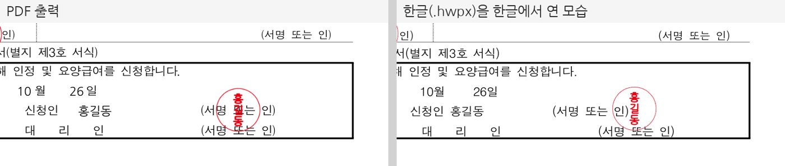

# 산재 신청 도우미(sanjae-apply) 사용 매뉴얼

설치부터 실제로 서식을 채워 저장하기까지의 전 과정을 적었습니다.
모든 절차는 2026년 10월 27일에 공개 패키지로 실제로 돌려 본 결과를 바탕으로 합니다(맨 끝 「실측 기록」).

> [!IMPORTANT]
> 이 매뉴얼은 0.5.3 기준입니다. 파일 바로 저장(`save_to`)·모르는 칸 알림(`unknown_keys`)·타원 도장 수정은 0.5.3 부터 들어 있습니다. 설치된 판은 `npm view sanjae-apply version` 으로 확인합니다. 0.5.2 이하면 `npx -y sanjae-apply@latest` 로 새로 받습니다.

## 0. 범위

| 하는 일 | 하지 않는 일 |
|---|---|
| 급여 종류와 재해 상황을 받아 필요한 서식·첨부·근거 조문을 정리합니다 | 승인 여부를 판단하거나 결과를 점치지 않습니다 |
| 근로복지공단 정본 서식 12종에 값을 넣어 PDF 또는 한글(.hwpx) 파일을 만듭니다 | 공단 토탈서비스에 접수하지 않습니다 |
| 성명인·법인형 도장 그림을 만들어 서명란에 찍습니다 | 등록 인감을 대신하지 않습니다 |
| 입력값을 이 PC 안에서만 처리합니다(로컬 설치) | 입력값을 저장하거나 밖으로 보내지 않습니다 |

출력물은 제출 전에 담당 노무사가 확인한 뒤 씁니다.

## 1. 준비물

| 항목 | 필요 여부 | 확인 방법 |
|---|---|---|
| Node.js 20 이상 | 필수 | 터미널에서 `node -v` 가 `v20` 이상이면 됩니다 |
| 인터넷 | 처음 한 번 | 패키지(약 4MB)를 받을 때만 씁니다 |
| 한글 2014 이상 | 선택 | 한글(.hwpx) 출력을 열어 고칠 때만 씁니다. 만드는 데는 필요 없습니다 |
| AI 클라이언트 | 선택 | Claude Code·Claude Desktop 등. 명령줄만 써도 됩니다 |

Node.js 가 없으면 nodejs.org 에서 LTS 판을 받아 설치합니다.

## 2. 설치

자기 환경에 맞는 것 하나만 하면 됩니다.

| 쓰는 곳 | 절 | 실측 |
|---|---|---|
| Claude Code | 2-1 | ✅ 연결·질문·저장·날인 |
| Claude Desktop | 2-2 | ✅ 연결(도구 목록까지) |
| Cursor·Windsurf 등 | 2-3 | 확인하지 않음 |
| 명령줄만 | 2-4 | ✅ 전 명령 |
| 원격 서버(토큰 발급받은 경우) | 2-5 | ✅ 31건 |

### 2-0. 먼저 한 번 받아 두기(권장)

```bash
npx -y sanjae-apply --help
```

처음 실행은 패키지를 받느라 약 18초 걸렸고 그 뒤로는 8초 안팎입니다.
AI 클라이언트는 서버가 30초 안에 응답하지 않으면 연결을 끊는 경우가 있습니다. 미리 한 번 받아 두면 첫 연결이 끊기지 않습니다.

### 2-1. Claude Code

```bash
claude mcp add --scope user sanjae-apply -- npx -y sanjae-apply mcp
claude mcp list
```

목록에 `sanjae-apply: npx -y sanjae-apply mcp - ✔ Connected` 가 보이면 끝입니다.
`--scope user` 는 모든 폴더에서 쓰게 합니다. 한 프로젝트에서만 쓰려면 이 옵션을 빼고 그 폴더에서 실행합니다.

### 2-2. Claude Desktop

아래 위치의 설정 파일을 메모장 같은 편집기로 엽니다.

| 운영체제 | 설정 파일 위치 |
|---|---|
| 윈도우 | `%APPDATA%\Claude\claude_desktop_config.json` |
| 맥 | `~/Library/Application Support/Claude/claude_desktop_config.json` |

파일에 이미 다른 항목이 있으면 지우지 말고 `mcpServers` 만 더합니다.

```json
{
  "mcpServers": {
    "sanjae-apply": { "command": "npx", "args": ["-y", "sanjae-apply", "mcp"] }
  }
}
```

저장한 뒤 Claude Desktop 을 작업 표시줄 알림 영역의 아이콘까지 종료하고 다시 켭니다.
연결 여부는 로그로 볼 수 있습니다. 윈도우 스토어판은 `%LOCALAPPDATA%\Claude\Logs\mcp-server-sanjae-apply.log` 에 남습니다. `method="tools/list"` 다음 줄에 `Message from server: id=1 result` 가 있으면 연결된 것입니다.

윈도우에서 `npx` 를 못 찾는다는 오류가 나면 `cmd /c` 로 감쌉니다.

```json
{
  "mcpServers": {
    "sanjae-apply": { "command": "cmd", "args": ["/c", "npx", "-y", "sanjae-apply", "mcp"] }
  }
}
```

### 2-3. Cursor·Windsurf·그 밖의 MCP 클라이언트

각 도구의 MCP 설정에 같은 `command` 와 `args` 를 넣습니다. stdio 방식을 받는 클라이언트면 같은 방법으로 붙습니다.
이 클라이언트들에서는 직접 확인하지 않았습니다. 같은 명령을 공식 SDK 클라이언트로 띄워 도구 5개가 모두 응답하는 것까지 확인했습니다.

### 2-4. 명령줄만 쓰기

설치 과정이 따로 없습니다. 4절의 명령을 그대로 실행하면 됩니다.
자주 쓰면 전역 설치로 시작 시간을 줄일 수 있습니다. 실측에서 한 번 실행이 8초 안팎에서 2.5초로 줄었습니다.

```bash
npm install -g sanjae-apply
sanjae-apply --help
```

### 2-5. 원격 서버

운영자가 토큰을 준 경우에만 씁니다. 입력은 서버에 저장되지 않지만 네트워크를 거칩니다.

```bash
claude mcp add --transport http --scope user sanjae-apply https://sanjae-apply.vercel.app/api/mcp/mcp --header "Authorization: Bearer <발급받은 토큰>"
```

원격 서버에서는 파일을 바로 저장하는 `save_to` 를 쓸 수 없습니다. 결과는 base64 로 돌아옵니다.

## 3. 처음 써 보기(AI 클라이언트)

연결한 뒤 아래 문장을 그대로 넣어 봅니다. 괄호 안은 실측에서 AI 가 부른 도구입니다.

1. 「출퇴근 중 교통사고인데 상대 운전자가 있어요. 요양급여 신청하려면 뭐가 필요해요?」
   (`list_required_forms`) 필수 서식 4종(요양급여 신청서·소견서·출퇴근재해 발생신고서·제3자 재해 신고서)과 첨부, 근거 조문이 나옵니다.
2. 「요양급여신청서를 이 폴더의 values.json 값으로 채워서 이 폴더에 신청서.pdf 로 저장해줘.」
   (`get_form_catalog` → `fill_form`) 작업 폴더에 `신청서.pdf` 가 생깁니다.
3. 「요양급여신청서를 values.json 값으로 한글 파일로 채우고 홍길동 이름으로 도장도 신청인 자리에 찍어서 신청서_도장.hwpx 로 저장해줘.」
   (`fill_form` 의 `stamp`) 한글 파일에 도장 그림이 들어갑니다.

`values.json` 은 4-3 의 모양으로 만듭니다. 값이 없으면 AI 에게 직접 불러 줘도 됩니다.

> [!NOTE]
> 0.5.2 까지는 결과가 base64 로만 돌아와서 Claude Code 가 파일을 작업 폴더로 옮길 때마다 승인을 물었습니다. 0.5.3 부터 로컬 설치는 `save_to` 로 지정한 경로에 바로 씁니다. 이미 있는 파일은 덮어쓰지 않습니다.

## 4. 명령줄 사용법

### 4-1. 필요 서식 확인(`check`)

```bash
npx -y sanjae-apply check YOYANG --accident COMMUTE --third-party yes
npx -y sanjae-apply check JANGHAE --tags NOISE_HEARING_LOSS --json
npx -y sanjae-apply check YOYANG --have A_MEDICAL_OPINION
```

| 급여 코드 | 급여 |
|---|---|
| `YOYANG` | 요양급여 |
| `HUYEOP` | 휴업급여 |
| `CARE_TRANSPORT_DEVICE` | 간병료·이송비·보조기 |
| `JANGHAE` | 장해급여 |
| `YUJOK` | 유족급여 |
| `UNPAID` | 미지급 보험급여 |
| `ADDITIONAL_DISEASE` | 추가상병 |
| `RE_YOYANG` | 재요양 |
| `SELF_PAY` | 본인부담 치료비 |

| 옵션 | 값 | 뜻 |
|---|---|---|
| `--accident` | `WORK_ACCIDENT` · `COMMUTE` · `DISEASE` | 업무상 사고 · 출퇴근 · 질병 |
| `--third-party` | `yes` · `no` | 상대방(제3자)이 있는가 |
| `--ended` | `yes` · `no` | 치료가 끝났는가 |
| `--tags` | `NOISE_HEARING_LOSS` 등 | 소음성 난청·척추/신경·관절·보조기 |
| `--have` | 첨부 id(쉼표 구분) | 이미 가진 첨부. 결과에서 `PROVIDED` 로 바뀝니다 |
| `--json` | 없음 | 사람용 표 대신 JSON |

결과의 서식 상태는 `REQUIRED`(필수) · `CONDITIONAL`(조건부) · `NOT_APPLICABLE`(해당 없음)입니다. 답하지 않은 분기는 `open_confirmations` 에 질문으로 돌아옵니다.
`READY_TO_SUBMIT` 은 서식과 첨부가 갖춰졌다는 표시입니다. 승인과는 관계가 없습니다.

### 4-2. 서식 대장과 칸 이름(`catalog`)

```bash
npx -y sanjae-apply catalog                 # 채울 수 있는 서식 목록
npx -y sanjae-apply catalog F_YOYANG_APPLY  # 그 서식의 칸 이름(slots)·도장 자리(stamps)·개정일
```

### 4-3. 서식 채우기(`fill`)

먼저 `values.json` 을 만듭니다. 칸 이름은 `catalog <서식>` 의 `slots` 에 있는 이름만 씁니다.

```json
{
  "name": "홍길동",
  "claim_kind_accident": true,
  "apply_year": "2026",
  "apply_month": "10",
  "apply_day": "27",
  "applicant_name": "홍길동"
}
```

- 체크 칸은 `true` 일 때만 찍힙니다. `false` 나 빈 문자열은 비워 둡니다.
- 주민등록번호 같은 칸은 빼고 출력한 뒤 손으로 적어도 됩니다.
- 칸보다 긴 글은 글자를 줄여 칸 안에 넣습니다.

```bash
npx -y sanjae-apply fill F_YOYANG_APPLY values.json --out 신청서.pdf
npx -y sanjae-apply fill F_YOYANG_APPLY values.json --out 신청서.hwpx
```

확장자로 형식이 정해집니다. PDF 와 한글은 칸 이름이 같습니다.

실행하면 결과가 JSON 으로 나옵니다.

| 항목 | 뜻 | 볼 것 |
|---|---|---|
| `written`(PDF) · `filled`(한글) | 넣은 칸 수 | 기대한 수와 같은가 |
| `skipped` | 값이 없어 비운 칸 | 비우면 안 되는 칸이 있는가 |
| `unknown_keys` | 서식에 없는 칸 이름(0.5.3~) | 비어 있어야 합니다. 있으면 오타이거나 다른 서식의 칸 이름입니다 |
| `shrunk` | 길어서 글자를 줄인 칸 | 출력물에서 읽히는가 |
| `stamped` · `stamps_skipped` | 도장을 찍은 자리 · 못 찍은 자리 | 4-4 |

### 4-4. 도장

이름만 주면 도장을 만들어 찍습니다.

```bash
npx -y sanjae-apply fill F_YOYANG_APPLY values.json --out 신청서.pdf --stamp 홍길동
npx -y sanjae-apply fill F_YOYANG_APPLY values.json --out 신청서.hwpx --stamp 홍길동 --stamp-shape ellipse
npx -y sanjae-apply fill F_YOYANG_APPLY values.json --out 신청서.pdf --stamp-png 내도장.png --stamp-spot applicant
```

| 옵션 | 뜻 |
|---|---|
| `--stamp <이름>` | 성명인을 만들어 찍습니다 |
| `--stamp-png <파일>` | 가진 도장 그림(투명 배경 PNG, 4096px 이하)을 찍습니다 |
| `--stamp-shape` | `circle`(기본) · `square` · `ellipse` |
| `--stamp-spot` | 찍을 자리(쉼표 구분). 비우면 신청인 본인 자리 전부 |

자리 이름은 서식마다 다릅니다(5절 표). 비우면 `applicant`(본문) · `delegation`(위임장) · `consent`(개인정보 동의) 중 그 서식에 있는 것 전부에 찍습니다. 확인자·신고인처럼 다른 사람의 서명란은 `--stamp-spot` 으로 이름을 적을 때만 찍습니다.

도장 그림만 따로 만들 수도 있습니다.

```bash
npx -y sanjae-apply seal --out 도장.png --name 홍길동
npx -y sanjae-apply seal --out 도장.png --name 김대표 --shape square
npx -y sanjae-apply seal --out 직인.png --arc "가나다 주식회사" --center 대표이사 --bottom 123-45-67890 --inner 2
```



- 도장은 명의자의 인격 표지입니다. 본인이거나 명의자가 동의한 이름만 넣습니다.
- 동봉 글꼴(나눔고딕)에 없는 글자(한자 등)는 빈 도장이 되지 않도록 오류로 멈춥니다. 한자 이름은 가진 도장 그림을 `--stamp-png` 로 넣습니다.
- 한글 출력에서 도장은 서명란 위에 떠 있는 그림입니다. 한글에서 옮기거나 지울 수 있고 글자를 밀지 않습니다.

## 5. 채울 수 있는 서식 12종

| 서식 id | 서식 | 칸 수 | 한글 | 도장 자리 |
|---|---|---:|:-:|---|
| `F_YOYANG_APPLY` | 요양급여신청서(별지 제2호, 2026.7.7 개정) | 35 | ✅ | applicant, delegation, consent |
| `F_COMMUTE_REPORT` | 출퇴근 재해 합본(신청서 + 발생신고서) | 79 | ✅ | applicant, delegation, consent, commute_reporter |
| `F_THIRD_PARTY_REPORT` | 제3자 재해 신고서 + 확인서 | 48 | ✅ | applicant, confirm |
| `F_YUJOK_CLAIM` | 유족급여 청구서 | 75 | ✅ | applicant, consent |
| `F_SELF_PAY_CLAIM` | 본인부담 치료비 청구서 | 42 | ✅ | applicant, delegation, consent, substitute_applicant |
| `F_HUYEOP_CLAIM` | 휴업급여 청구서 | 37 | ✅ | applicant, delegation |
| `F_CARE_TRANSPORT_DEVICE_CLAIM` | 간병료·이송비·보조기 청구서 | 44 | ✅ | applicant, delegation, consent |
| `F_DEVICE_PRESCRIPTION` | 재활보조기구 처방전 | 12 | PDF 만 | 없음(의료기관 작성) |
| `F_UNPAID_CLAIM` | 미지급 보험급여 청구서 | 62 | ✅ | applicant |
| `F_JANGHAE_CLAIM` | 장해급여 묶음(청구서 + 소음작업 확인서 + 선택 확인서) | 153 | ✅ | applicant, delegation, consent, noise_applicant, choice_confirmer |
| `F_ADDITIONAL_DISEASE_APPLY` | 추가상병 신청서 | 25 | ✅ | applicant, delegation, consent |
| `F_RE_YOYANG_APPLY` | 재요양 신청서 | 39 | ✅ | applicant, delegation, consent |

공단은 서식을 예고 없이 바꿉니다. `catalog` 로 개정일을 가끔 확인하고 새 판은 `npx -y sanjae-apply@latest` 로 받습니다.

## 6. MCP 도구

| 도구 | 하는 일 | 로컬 전용 인자 |
|---|---|---|
| `list_required_forms` | 급여·재해 분기 → 서식·첨부·조문·남은 질문 | 없음 |
| `get_form_catalog` | 서식 대장·칸 이름·도장 자리 | 없음 |
| `fill_form` | 서식 채우기(+ 도장). PDF 또는 한글 | `save_to`: 저장할 절대 경로 |
| `make_seal` | 도장 그림 만들기 | `save_to`: 저장할 절대 경로(.png) |
| `fill_yoyang_apply` | 요양급여신청서 채우기(예전 판 호환) | 없음 |

`save_to` 는 절대 경로만 받습니다. 확장자가 형식과 다르거나 폴더가 없거나 이미 파일이 있으면 아무것도 쓰지 않고 오류를 돌려줍니다.

## 7. 문제 해결

| 증상 | 원인 | 해결 |
|---|---|---|
| Claude Desktop 로그에 `npx` 를 못 찾는다는 오류 | 윈도우에서 경로를 못 읽는 경우 | 2-2 의 `cmd /c` 설정 |
| 연결 시간 초과 | 첫 실행에 패키지를 받느라 늦음 | 2-0 처럼 한 번 미리 받아 둡니다 |
| `동봉 글꼴(나눔고딕)에 없는 글자` | 한자 등 이름 | `--stamp-png` 로 가진 도장 그림 |
| `--stamp-spot` 에 쓴 자리가 `지도에 없다` | 자리 이름 오타 | 5절 표의 이름. 조용히 넘어가지 않고 멈춥니다 |
| `도장 자리가 없다` | 처방전처럼 신청인 서명란이 없는 서식 | 도장 없이 채웁니다 |
| `unknown_keys` 에 이름이 있음 | 칸 이름 오타 또는 다른 서식 칸 | `catalog <서식>` 의 `slots` 와 맞춥니다 |
| `이미 있는 파일은 덮어쓰지 않는다` | `save_to` 경로에 파일이 있음 | 다른 이름을 줍니다 |
| 서식이 바뀌었다는 말을 들음 | 공단 개정 | `npx -y sanjae-apply@latest` |

개발자용 참고입니다.

- 이 저장소 폴더 안에서 `npx sanjae-apply` 를 부르면 npx 가 저장소 자신을 찾다가 실패합니다. 다른 폴더에서 부르거나 `node dist/src/cli.js` 를 씁니다.
- Git Bash 는 `cmd /c` 의 `/c` 를 경로로 바꿉니다. 시험 스크립트에 `cmd /c` 를 넘길 때는 `MSYS_NO_PATHCONV=1` 을 붙입니다.
- npm 에 새 패키지를 처음 올리면 1분쯤 `0.0.0-stage` 자리표시자만 보입니다. `npm view sanjae-apply version` 이 실제 버전을 낼 때까지 설치 안내를 바꾸지 않습니다.

## 8. 실측 기록(2026-10-27 KST)

윈도우 11 · Node 24.20 · npm 11.19 · 한글(HWPFrame) 로 돌렸습니다. 값은 전부 합성 값(`test/samples/`)입니다.

### 공개 패키지 0.5.2(npm)

| 표면 | 시험 | 결과 |
|---|---|---|
| 설치 | 빈 캐시에서 `npx -y sanjae-apply@0.5.2 --help` | ✅ 첫 실행 18.3초 · 다시 8.0초 |
| 전역 설치 | `npm install -g sanjae-apply` 뒤 `sanjae-apply check` | ✅ 한 번 실행 2.5초 |
| 명령줄 전수 | `check` 54조합(급여 9 × 재해 3 × 제3자 2)과 분기·태그·첨부 4건 | ✅ 58/58 |
| | `catalog` 전체와 12종 | ✅ 13/13 |
| | `fill` PDF 12종 · 한글 11종 | ✅ 23/23 |
| | `seal` 원형·사각·타원·법인형 | ✅ 4/4 |
| | 날인 PDF·한글(이름·타원·가진 PNG·자리 선택) | ✅ 5/5 |
| | 오류 7종(한자·자리 오타·자리 없는 서식·값 없는 옵션·옵션 충돌·없는 서식·PNG 형식이 틀린 파일) | ✅ 7/7 멈추고 이유를 알림 |
| PDF 육안 | 12종 글자 위치 + 픽셀 비교 | ✅ 실패 0 |
| 한글 렌더 | 11종을 한글이 실제로 열어 그림 · 쪽수 원본과 같음 | ✅ 실패 0 |
| 한글 날인 | 11종 32자리 × 원형·타원·법인형 PNG · 자리마다 쪽과 중심 ±3pt | ✅ 실패 0 |
| stdio MCP | Desktop 설정과 같은 `cmd /c npx -y sanjae-apply mcp` 와 `npx` 직접 | ✅ 도구 5개 전부 응답 |
| Claude Desktop | 설정에 한 줄 추가 후 실행 | ✅ initialize 12.7초 · tools/list 응답 |
| Claude Code | 3절 문장 3개(`claude -p`) | 질문 ✅ · 저장 2건은 승인 대기로 막힘 → 0.5.3 에서 고침 |
| 원격 MCP | 운영 끝점 드라이런 | ✅ 31/31 |
| Cursor·Windsurf | | 확인하지 않음 |
| Claude Desktop 대화창에서 도구 호출 | | 확인하지 않음 |

### 0.5.3(저장소 빌드)

| 표면 | 시험 | 결과 |
|---|---|---|
| 명령줄 전수 | 위와 같은 110건 | ✅ 110/110 |
| stdio MCP | 도구 5개 + 파일 바로 저장·덮어쓰기 거부 | ✅ 11/11 |
| Claude Code | 3절 문장 3개 | ✅ 3/3 · 저장 2건 모두 승인 없이 작업 폴더에 생성 |
| 한글 날인(타원) | 11종 | ✅ 실패 0 |
| npm 게시판 0.5.3 으로 위 시험 다시 돌리기 | | 확인하지 않음(게시 뒤 실행) |

### 이번 실측에서 고친 것(0.5.3)

| 발견 | 고친 내용 | 확인 |
|---|---|---|
| 이름만 넣은 타원 도장은 글자가 위아래로 테두리를 넘었습니다 | 가로 타원에서는 이름을 한 줄로 놓습니다 | 시험 추가 · 한글 날인 11종 다시 통과 |
| Claude Code 에서 「저장해줘」가 승인 없이는 끝나지 않았습니다 | 로컬 설치에 `save_to` 를 열었습니다 | 시험 3건 추가 · Claude Code 3건 모두 저장까지 완료 |
| 서식에 없는 칸 이름을 조용히 버렸습니다 | 결과에 `unknown_keys` 로 알립니다 | 명령줄·MCP 시험 추가 |
| 날인 검증 도구가 동봉 PDF 의 그림 수를 기준으로 셌습니다 | 같은 값으로 채우고 도장만 뺀 한글 렌더를 기준으로 셉니다 | 11종 통과 |
| 장해급여 확인자 자리의 한글 쪽 번호가 PDF 쪽(7)으로 적혀 있었습니다 | 한글 렌더 실측(8쪽)으로 고쳤습니다. 도장 위치는 원래 맞았습니다 | 시험 추가 |

전체 자동 시험은 212건이 통과합니다.

## 9. 다시 검증하는 법

```bash
# 저장소에서
npm ci && npm run build && npm test

# 공개 패키지 전수(명령줄): npx 로 한 번 받은 뒤 그 cli.js 를 넘깁니다
node scripts/e2e_published.mjs <npm 캐시>/_npx/<해시>/node_modules/sanjae-apply/dist/src/cli.js out/

# stdio MCP(저장소 밖 폴더에서)
node <저장소>/scripts/e2e_mcp_stdio.mjs out/ npx -y sanjae-apply mcp

# PDF 글자 위치·픽셀
python scripts/verify_fill.py out.pdf forms/maps/F_YOYANG_APPLY.json test/samples/F_YOYANG_APPLY.json out.jpg forms/bundled/F_YOYANG_APPLY.pdf

# 한글 렌더(한글이 있는 윈도우)
python scripts/verify_hwpx_fill.py out.hwpx test/samples/F_YOYANG_APPLY.json forms/hwpx_maps/F_YOYANG_APPLY.json out.jpg
python scripts/verify_hwpx_stamps.py out/ --shape ellipse
```
